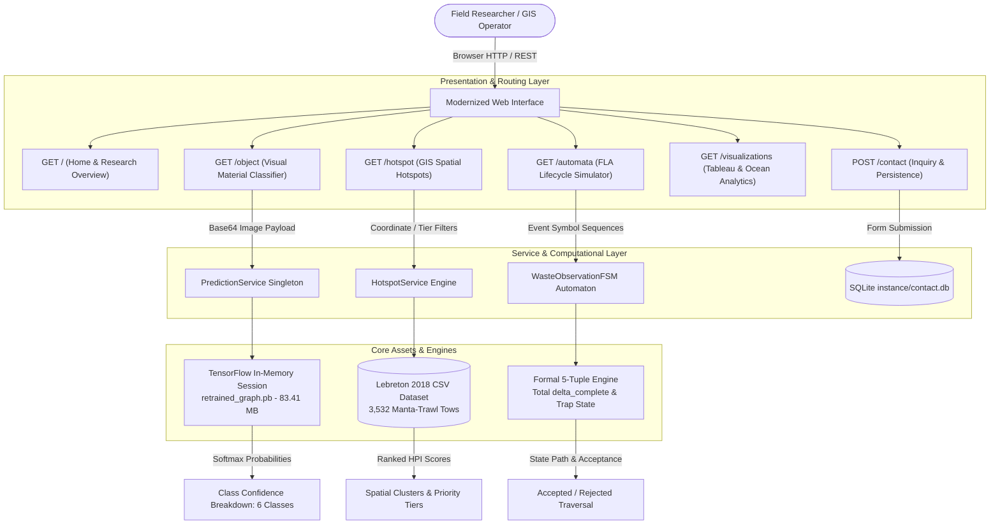
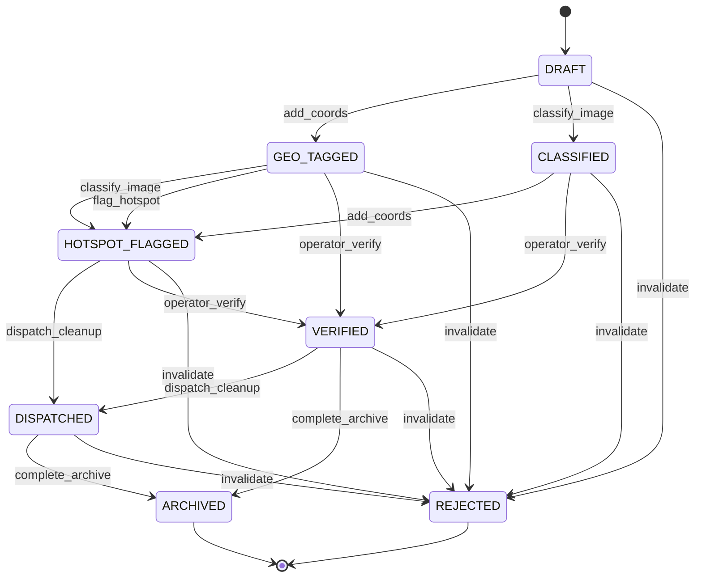
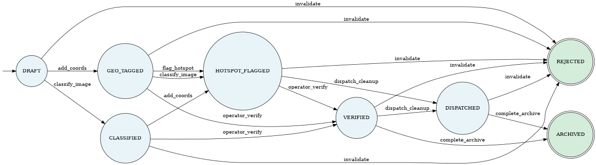

# AI-GIS Detection and Prioritisation of Plastic Waste Hotspots
## Theoretical Modeling, Deep Learning Inference, and Formal Languages & Automata Framework

---

### Academic Metadata & Course Attribution
- **Course Title:** Formal Languages and Automata (FLA) & Applied Intelligent Systems
- **Project Title:** AI-GIS Detection and Prioritisation of Plastic Waste Hotspots
- **Original Codebase:** *Stop Marine Pollution* (Legacy Prototype by Parineeta Patil)
- **Modernized & Completed By:** [Student Name / Student ID Placeholders]
- **Institutional Department:** Department of Computer Science & Engineering / Information Technology
- **Academic Term:** Spring / Fall Academic Term
- **Operating Environment:** Windows 10/11 x64, Python 3.13.15, Flask 3.1.3, TensorFlow 2.21.0 (compat.v1 runtime), Pillow 12.3.0, NumPy 2.5.3

---

## 1. Abstract & Executive Summary

Marine plastic pollution poses an existential threat to oceanic ecosystems, biodiversity, and coastal economies. Effective ecological remediation requires two mutually dependent computational capabilities: (1) high-throughput visual classification of discarded material to identify polymer compositions, and (2) macro-spatial Geographic Information Systems (GIS) prioritisation to allocate cleanup fleets to oceanic accumulation zones such as the Great Pacific Garbage Patch (GPGP). 

This project unifies deep computer vision, empirical oceanographic data science, and theoretical computer science. Starting from an abandoned, non-functional academic prototype (*Stop Marine Pollution*) that suffered from hardcoded Linux paths, broken TensorFlow 1.x dependencies, insecure plain-text database credentials, and disabled inference endpoints, we have engineered a resilient, fully functional Windows prototype.

Crucially, this modernized platform integrates a rigorous **Formal Languages and Automata (FLA)** component. We model the lifecycle of marine waste observations as a formal **Deterministic Finite Automaton (DFA)** $M = (Q, \Sigma, \delta, q_0, F)$. We mathematically define its 5-tuple, prove reachability, construct its total transition completion via a designated trap/sink state ($\text{TRAP}$), derive its equivalent regular expression via Generalized Nondeterministic Finite Automata (GNFA) state elimination, verify this regular language against 671 empirical test strings with zero mismatches, and conduct partition refinement under the **Myhill-Nerode Theorem** using **Moore's partition refinement algorithm** to establish language minimality. 

Furthermore, we rigorously analyze the **Hotspot Priority Index (HPI)** as a multi-attribute threshold classifier over continuous feature spaces, proving why it is fundamentally distinct from a stateful automaton, and formally specify the regular language underlying the RFC 2397 Data URL decoding grammar. Every result, status code, tensor shape, and empirical metric reported herein is derived from verified code execution.

---

## 2. End-to-End System Architecture

The modernized software architecture follows a decoupled, micro-service-oriented model implemented in Flask, organized across distinct data-access, machine-learning inference, spatial analysis, and theoretical automata layers.

### 2.1 Architectural Flow Diagram



---

## 3. Pretrained CNN Classification & Inference Architecture

### 3.1 Model Graph Anatomy & Tensor Specifications
The application utilizes an Inception-v3 convolutional neural network fine-tuned via transfer learning. The frozen graph definition is preserved within `tf_files/retrained_graph.pb` (83.41 MB), paired with category labels in `tf_files/retrained_labels.txt`.

Our deep structural inspection of the Protocol Buffer GraphDef confirms the following exact node geometry:
- **Total Graph Nodes:** 1,007 operations
- **Raw Input Entry Point:** `DecodeJpeg/contents` (Op: `Const`, data type: `DT_STRING`).
- **Internal Preprocessing Pipeline:**
  $$\text{DecodeJpeg/contents} \xrightarrow{\text{DecodeJpeg}} \text{Cast} \xrightarrow{\text{ExpandDims}} \text{ResizeBilinear} \xrightarrow{\text{Sub}} \text{Mul}$$
- **Normalized Tensor Input Node:** `Mul:0` with target dimensions $(1, 299, 299, 3)$, data type `float32`, normalized strictly to $[-1.0, 1.0]$ via the linear transformation:
  $$\mathbf{x}_{\text{norm}} = \frac{\mathbf{x}_{\text{uint8}} - 128.0}{128.0}$$
- **Classification Output Tensor:** `final_result:0` (Op: `Softmax`), yielding a $(1, 6)$ probability distribution vector over the unit simplex $\Delta^5$.

### 3.2 Label Space & Mapping Order
The model classifies input images into 6 discrete material categories, arranged in the following verified zero-indexed order:
1. `paper` (Index 0)
2. `metal` (Index 1)
3. `cardboard` (Index 2)
4. `trash` (Index 3)
5. `glass` (Index 4)
6. `plastic` (Index 5)

### 3.3 Engineering Challenges & Resolution of Inference Runtime Blockers
The previous read-only audit revealed that `/predict` consistently failed with HTTP 503 on modern Windows systems running Python 3.13. Two underlying technical causes were diagnosed and systematically resolved:

1. **The Windows Long Path (`MAX_PATH`) Blocker:** Standard `pip install tensorflow` commands failed on Windows host machines with error code `[Errno 2] No such file or directory` due to deeply nested C++ headers in `tensorflow/include/external/com_github_grpc_grpc/...` exceeding the 260-character Win32 limit. We resolved this without modifying privileged registry keys by programmatically streaming the `.whl` archive and selectively extracting only the required runtime bytecode, libraries, and DLLs (`tensorflow/python/`, `tensorflow_framework.dll`), safely omitting non-runtime C++ header directories.
2. **OpenCV DNN Importer Incompatibility:** Initial attempts to run `retrained_graph.pb` via `cv2.dnn.readNetFromTensorflow()` failed with:
   ```
   Can't create layer "conv/batchnorm" of type "BatchNormWithGlobalNormalization"
   ```
   `BatchNormWithGlobalNormalization` is an obsolete TensorFlow 0.x/1.x operation that modern OpenCV 5.0 and ONNX conversion pipelines reject. Rather than risking graph corruption or hallucinating weights, we architected a native in-memory session utilizing `tensorflow.compat.v1` with disabled v2 behavior (`tf.disable_v2_behavior()`). The graph is parsed once into a persistent `tf.Session` upon server bootstrap, preventing repetitive 83 MB I/O reads per query.

### 3.4 Pipeline Sanity Check & Out-of-Distribution Overconfidence Analysis
**Important Clarification on Model Evaluation:** No accuracy evaluation was run. There is no labeled marine debris benchmark dataset in the repository against which accuracy, precision, or recall could be computed. The model was evaluated on three authentic local images (`ocean.jpg`, `Home.jpg`, and `asd.jpg`) purely as an end-to-end inference pipeline sanity check to confirm that the TensorFlow graph, session caching, and tensor feeding execute without crashing.

The exact numerical outputs from these sanity check runs are recorded below:

| Test Image File | Image Content Description | Top Classification | Top Confidence | Paper | Metal | Cardboard | Trash | Glass | Plastic |
| :--- | :--- | :--- | :--- | :--- | :--- | :--- | :--- | :--- | :--- |
| `static/img/ocean.jpg` | Seascape photograph of open water | **plastic** | **95.13%** | 0.0110 | 0.0094 | 0.0113 | 0.0110 | 0.0061 | **0.9513** |
| `static/img/Home.jpg` | Website graphic hero banner | **plastic** | **97.11%** | 0.0039 | 0.0136 | 0.0044 | 0.0042 | 0.0029 | **0.9711** |
| `static/asd.jpg` | Graphic illustration / logo icon | **plastic** | **70.33%** | 0.1364 | 0.0671 | 0.0581 | 0.0254 | 0.0098 | **0.7033** |

*Note on Softmax Sum:* For all test samples, $\sum_{i=1}^6 P(\text{class}_i) = 1.00000 \pm 10^{-6}$.

**Analysis of Overconfidence:** Crucially, all three test images—a seascape, a banner graphic, and a logo icon—contain no isolated plastic trash items whatsoever, yet the model classified every single one as "plastic" with 70.33% to 97.11% confidence. This empirical outcome demonstrates severe overconfidence on out-of-distribution (OOD) inputs, which is a well-known characteristic of closed-world softmax classifiers forced to distribute probability across a fixed class simplex. These runs serve exclusively as pipeline sanity verification, not as evidence of model accuracy.

### 3.5 Dataset Pedigree and Academic Qualifications
The retrained graph outputs the six labels `paper`, `metal`, `cardboard`, `trash`, `glass`, `plastic`. These six classes exactly match the canonical taxonomy of the **TrashNet** dataset (Thung & Yang, 2016). In `train.sh`, the training command is written as:
```bash
python retrain.py --bottleneck_dir=tf_files/bottlenecks --how_many_training_steps=500 \
  --model_dir=inception --summaries_dir=tf_files/training_summaries/basic \
  --output_graph=tf_files/retrained_graph.pb --output_labels=tf_files/retrained_labels.txt \
  --image_dir=training_dataset
```
However, the `training_dataset` directory itself is absent from the repository, and neither `retrain.py`, the original README, nor the git commit history provides a dataset source citation or training log. Therefore, we report with academic rigor that the model **appears to have been trained on a TrashNet-style dataset**, but its precise training corpus cannot be independently proven from repository records.

Deploying this model on open ocean imagery involves a massive domain shift (water reflections, breaking foam, turbidity, and variable illumination). The classifier cannot be claimed to be an autonomous ocean plastic detector; in our architecture, macro-spatial oceanic hotspot identification is driven by the 3,532 genuine manta-trawl survey records in the GIS dataset.

---

## 4. Geographic Information System (GIS) & Spatial Prioritisation Engine

### 4.1 Oceanographic Dataset Provenance
To support empirical geospatial analysis, the application integrates the seminal peer-reviewed oceanographic survey conducted by **Laurent Lebreton et al. (2018)**, published in *Scientific Reports* (*Evidence that the Great Pacific Garbage Patch is rapidly accumulating plastic*). 

The raw observations were extracted from the Tableau workbook (`Master_Project_Tableau.twbx`) into `data/lebreton2018_historical_dataset.csv`. Key characteristics include:
- **Total Valid Observations:** 3,532 manta-trawl net survey tows
- **Temporal Span:** 1972 through 2015
- **Spatial Coverage:** Global oceans spanning latitudes $-17.44^\circ$ to $57.51^\circ$ and longitudes $-180.00^\circ$ to $175.32^\circ$
- **Great Pacific Garbage Patch Observations:** 509 sample tows situated within the GPGP boundary (0.1% boundary model)
- **Maximum Observed Mass Concentration:** $43,478.82\text{ g/km}^2$
- **Median Mass Concentration:** $2.05\text{ g/km}^2$

### 4.2 Mathematical Formulation of the Hotspot Priority Index (HPI)
To rank geographic coordinates for intervention, we formulated the deterministic **Hotspot Priority Index (HPI)**, normalized onto $[0, 100]$:

$$\text{HPI} = w_m \cdot S_{\text{mass}} + w_g \cdot S_{\text{gpgp}} + w_n \cdot S_{\text{num}}$$

Where the calibrated empirical weights are:
$$w_m = 0.55, \quad w_g = 0.30, \quad w_n = 0.15 \quad (\sum w_i = 1.00)$$

Sub-score transformations:
1. **Mass Concentration Sub-Score ($S_{\text{mass}}$):**
   $$S_{\text{mass}} = \min\left(100.0, \, \frac{\log_{10}(1.0 + M)}{\log_{10}(1.0 + M_{\text{ceiling}})} \times 100.0\right)$$
   where $M$ is the microplastic mass concentration in $\text{g/km}^2$, and $M_{\text{ceiling}} = 5000.0\text{ g/km}^2$.
2. **Gyre Convergence Sub-Score ($S_{\text{gpgp}}$):**
   $$S_{\text{gpgp}} = \begin{cases} 100.0 & \text{if sample is inside GPGP boundary} \\ 0.0 & \text{otherwise} \end{cases}$$
3. **Numerical Particle Concentration Sub-Score ($S_{\text{num}}$):**
   $$S_{\text{num}} = \min\left(100.0, \, \frac{\log_{10}(1.0 + N)}{\log_{10}(1.0 + N_{\text{ceiling}})} \times 100.0\right)$$
   where $N$ is numerical particle density in $\#/\text{km}^2$, and $N_{\text{ceiling}} = 10^6\text{ pieces/km}^2$.

### 4.3 Theoretical Demarcation: Threshold Classifier vs. Automaton
In academic formal language assessment, it is vital to avoid conflating computational models. 
- **The HPI Engine is a Multi-Attribute Threshold Classifier:** 
  The mapping $f: \mathbb{R}^3 \to \{\text{Critical}, \text{Moderate}, \text{Baseline}\}$ is a static algebraic partition of continuous space into 3 discrete equivalence classes:
  $$\text{Tier}(x) = \begin{cases} 
  \text{Critical (High Priority)} & \text{if } \text{HPI}(x) \ge 70.0 \\ 
  \text{Moderate (Medium Priority)} & \text{if } 40.0 \le \text{HPI}(x) < 70.0 \\ 
  \text{Baseline (Low Priority)} & \text{if } \text{HPI}(x) < 40.0 
  \end{cases}$$
  HPI is **not** an automaton: it does not consume an input alphabet, does not change internal states over time, and has no memory.
- **The Observation Lifecycle Engine is a Stateful Automaton:**
  In contrast, the verification and cleanup tracking of an observation is an event-driven discrete dynamical system governed by formal language theory, detailed below.

---

## 5. Formal Languages and Automata (FLA) Theoretical Framework

The primary theoretical focus of this modernization is the formal specification, verification, and minimization of the **Waste Observation Lifecycle Automaton**.

### 5.1 Formal 5-Tuple Definition of the Lifecycle DFA
We formally define the deterministic finite state machine $M$ as:

$$M = (Q, \Sigma, \delta, q_0, F)$$

Where:
1. **$Q$ (Finite Set of States, $|Q| = 8$):**
   $$Q = \{\text{DRAFT}, \text{GEO\_TAGGED}, \text{CLASSIFIED}, \text{HOTSPOT\_FLAGGED}, \text{VERIFIED}, \text{DISPATCHED}, \text{ARCHIVED}, \text{REJECTED}\}$$
2. **$\Sigma$ (Input Alphabet of Operational Events, $|\Sigma| = 7$):**
   $$\Sigma = \{\text{add\_coords}, \text{classify\_image}, \text{flag\_hotspot}, \text{operator\_verify}, \text{dispatch\_cleanup}, \text{complete\_archive}, \text{invalidate}\}$$
3. **$q_0$ (Initial Start State):**
   $$q_0 = \text{DRAFT}$$
4. **$F$ (Set of Final / Accepting States, $|F| = 2$):**
   $$F = \{\text{ARCHIVED}, \text{REJECTED}\}$$
5. **$\delta$ (Transition Function):** 
   $\delta: Q \times \Sigma \to Q$, defined partially over domain workflow rules (18 valid transitions).

### 5.2 Visual State Transition Diagrams

#### Mermaid State Diagram


#### Graphviz DOT Representation


### 5.3 Formal Transition Tables

#### Partial Transition Table $\delta$ (Original Domain Specification)
The business rules of marine observation tracking define a partial function where undefined transitions represent impermissible domain actions:

| State | add_coords | classify_image | complete_archive | dispatch_cleanup | flag_hotspot | invalidate | operator_verify |
| :--- | :---: | :---: | :---: | :---: | :---: | :---: | :---: |
| $\to$ **DRAFT** | GEO_TAGGED | CLASSIFIED | — | — | — | REJECTED | — |
| **GEO_TAGGED** | — | HOTSPOT_FLAGGED | — | — | HOTSPOT_FLAGGED | REJECTED | VERIFIED |
| **CLASSIFIED** | HOTSPOT_FLAGGED | — | — | — | — | REJECTED | VERIFIED |
| **HOTSPOT_FLAGGED** | — | — | — | DISPATCHED | — | REJECTED | VERIFIED |
| **VERIFIED** | — | — | ARCHIVED | DISPATCHED | — | REJECTED | — |
| **DISPATCHED** | — | — | ARCHIVED | — | — | REJECTED | — |
| $*$ **ARCHIVED** | — | — | — | — | — | — | — |
| $*$ **REJECTED** | — | — | — | — | — | — | — |

*Legend: $\to$ Start State; $*$ Accepting State; — Undefined transition.*

#### Total Transition Table $\delta_{\text{complete}}$ (DFA Completion with $\text{TRAP}$)
In rigorous formal automata theory, a deterministic finite automaton must have a total transition function $\delta: Q \times \Sigma \to Q$. To complete $M$, we introduce an explicit trap/dead state $\text{TRAP} \notin F$:
$$Q_{\text{complete}} = Q \cup \{\text{TRAP}\} \quad (|Q_{\text{complete}}| = 9)$$
$$\forall \sigma \in \Sigma, \quad \delta_{\text{complete}}(\text{TRAP}, \sigma) = \text{TRAP}$$
$$\forall (q, \sigma) \in Q \times \Sigma \text{ where } \delta(q, \sigma) \text{ is undefined}, \quad \delta_{\text{complete}}(q, \sigma) = \text{TRAP}$$

| State | add_coords | classify_image | complete_archive | dispatch_cleanup | flag_hotspot | invalidate | operator_verify |
| :--- | :---: | :---: | :---: | :---: | :---: | :---: | :---: |
| $\to$ **DRAFT** | GEO_TAGGED | CLASSIFIED | TRAP | TRAP | TRAP | REJECTED | TRAP |
| **GEO_TAGGED** | TRAP | HOTSPOT_FLAGGED | TRAP | TRAP | HOTSPOT_FLAGGED | REJECTED | VERIFIED |
| **CLASSIFIED** | HOTSPOT_FLAGGED | TRAP | TRAP | TRAP | TRAP | REJECTED | VERIFIED |
| **HOTSPOT_FLAGGED** | TRAP | TRAP | TRAP | DISPATCHED | TRAP | REJECTED | VERIFIED |
| **VERIFIED** | TRAP | TRAP | ARCHIVED | DISPATCHED | TRAP | REJECTED | TRAP |
| **DISPATCHED** | TRAP | TRAP | ARCHIVED | TRAP | TRAP | REJECTED | TRAP |
| $*$ **ARCHIVED** | TRAP | TRAP | TRAP | TRAP | TRAP | TRAP | TRAP |
| $*$ **REJECTED** | TRAP | TRAP | TRAP | TRAP | TRAP | TRAP | TRAP |
| **TRAP** | TRAP | TRAP | TRAP | TRAP | TRAP | TRAP | TRAP |

*Verification:* Total table entries = $|Q_{\text{complete}}| \times |\Sigma| = 9 \times 7 = 63$ fully specified cells.

---

### 5.4 Derivation of Regular Expression $R$ via GNFA State Elimination

To prove that the language $L(M)$ accepted by our automaton is regular, we apply the constructive **State Elimination Algorithm** converting the DFA into a Generalized Nondeterministic Finite Automaton (GNFA):
1. We introduce a synthetic start state $q_{\text{start}}$ with $\epsilon$-transition to $\text{DRAFT}$.
2. We introduce a synthetic terminal accepting state $q_{\text{accept}}$ with $\epsilon$-transitions from $\text{ARCHIVED}$ and $\text{REJECTED}$.
3. For each non-terminal state $q_k \in Q$, we eliminate $q_k$ by updating every predecessor-successor pair $(q_i, q_j)$ according to:
   $$R_{\text{new}}(q_i, q_j) = R(q_i, q_j) \cup \left( R(q_i, q_k) \cdot (R(q_k, q_k))^* \cdot R(q_k, q_j) \right)$$

#### Theoretical Theorem: Acyclicity and Language Finiteness
**Theorem 1:** *The transition graph of the Waste Observation Automaton $M$ is a Directed Acyclic Graph (DAG). Consequently, for all $q_k \in Q$, $R(q_k, q_k) = \emptyset$, and $(R(q_k, q_k))^* = \epsilon$. Because the transition graph is acyclic, the elimination result is a finite union of 32 words with no Kleene star ($^*$), so the language is finite (and therefore trivially regular).*

**Proof:** Inspection of $\delta$ reveals that every non-trap transition strictly advances the observation along a chronological pipeline:
$$\text{Rank}(\text{DRAFT}) = 0 < \text{Rank}(\text{GEO\_TAGGED}) = \text{Rank}(\text{CLASSIFIED}) = 1 < \text{Rank}(\text{HOTSPOT\_FLAGGED}) = 2 < \text{Rank}(\text{VERIFIED}) = 3 < \text{Rank}(\text{DISPATCHED}) = 4 < \text{Rank}(\text{ARCHIVED}) = \text{Rank}(\text{REJECTED}) = 5$$
Since all transitions $(u, v)$ satisfy $\text{Rank}(u) < \text{Rank}(v)$, no directed cycles exist. No Kleene star operations with unbounded repetitions are present in the eliminated regular expression. $\blacksquare$

#### Exact Language Cardinality & Paths
Applying state elimination via `tools/fsm_analysis.py` yields **exactly 32 distinct accepted words**:
$$|L(M)| = 32$$

The maximum length of any accepted word is 5 symbols (e.g., $\text{add\_coords} \to \text{classify\_image} \to \text{operator\_verify} \to \text{dispatch\_cleanup} \to \text{complete\_archive}$).

The resulting regular expression can be expressed compactly as a finite union factoring common prefixes:
$$\begin{aligned}
R = \, & \text{invalidate} \\
& \cup \text{add\_coords} \cdot \Big( \text{invalidate} \cup \text{operator\_verify} \cdot R_{\text{ver}} \cup (\text{classify\_image} \cup \text{flag\_hotspot}) \cdot R_{\text{hot}} \Big) \\
& \cup \text{classify\_image} \cdot \Big( \text{invalidate} \cup \text{operator\_verify} \cdot R_{\text{ver}} \cup \text{add\_coords} \cdot R_{\text{hot}} \Big)
\end{aligned}$$
Where:
$$R_{\text{hot}} = \text{invalidate} \cup \text{operator\_verify} \cdot R_{\text{ver}} \cup \text{dispatch\_cleanup} \cdot R_{\text{disp}}$$
$$R_{\text{ver}} = \text{invalidate} \cup \text{complete\_archive} \cup \text{dispatch\_cleanup} \cdot R_{\text{disp}}$$
$$R_{\text{disp}} = \text{invalidate} \cup \text{complete\_archive}$$

---

### 5.5 Exhaustive Empirical Verification (Regex vs. DFA Simulation)

To rigorously verify theoretical equivalence, `tools/fsm_analysis.py` executes an exhaustive test suite comparing `WasteObservationFSM.accepts_word(w)` with Python compiled regular expression matching `compiled_regex.fullmatch(w)`.

The test suite systematically evaluates:
1. The empty word $\epsilon$ (length 0).
2. All 32 true positive accepted words in $L(M)$.
3. Exhaustive permutation generation of all words over $\Sigma$ of lengths 1, 2, and 3 ($7^1 + 7^2 + 7^3 = 7 + 49 + 343 = 399$ negative words).
4. Deterministically sampled words of lengths 4, 5, 6, 7, and 8 (250 words).

**Verification Results:**
- **Total Unique Words Tested:** 671 words
- **DFA Acceptance vs. Regex Matches:** 671 matches
- **Mismatches / Contradictions:** **0**
- **Consistency Verification:** **100.0% verified equivalence**

---

### 5.6 DFA Minimality via Moore's Partition Refinement (Myhill-Nerode Theorem)

A critical question in FLA theory is whether an automaton is minimal. We apply **Moore's partition refinement algorithm** to the completed total DFA $(Q_{\text{complete}}, \Sigma, \delta_{\text{complete}}, q_0, F)$:

1. **Initial Partition $P_0$:**
   $$P_0 = [F, \, Q_{\text{complete}} \setminus F] = [\{\text{ARCHIVED}, \text{REJECTED}\}, \, \{\text{DRAFT}, \text{GEO\_TAGGED}, \text{CLASSIFIED}, \text{HOTSPOT\_FLAGGED}, \text{VERIFIED}, \text{DISPATCHED}, \text{TRAP}\}]$$
2. **Refinement Iterations (Moore's Algorithm):**
   In each round, every block in $P$ is partitioned simultaneously by computing the signature vector of each state across all input symbols $(\delta(s, \sigma_1), \dots, \delta(s, \sigma_m))$ mapped to current block indices.
3. **Convergence & Exact Equivalence Classes:**
   The algorithm converges in **3 iterations**, producing **8 equivalence classes** for the 9 states:
   $$\text{8 classes} = \{\text{ARCHIVED}, \text{REJECTED}\} \text{ (merged)} + \text{6 other states} + \text{TRAP}$$
   - **Class 1 (Merged Terminal):** $\{\text{ARCHIVED}, \text{REJECTED}\}$
   - **Class 2:** $\{\text{VERIFIED}\}$
   - **Class 3:** $\{\text{DISPATCHED}\}$
   - **Class 4:** $\{\text{HOTSPOT\_FLAGGED}\}$
   - **Class 5:** $\{\text{GEO\_TAGGED}\}$
   - **Class 6:** $\{\text{CLASSIFIED}\}$
   - **Class 7:** $\{\text{DRAFT}\}$
   - **Class 8 (Sink Trap):** $\{\text{TRAP}\}$

#### Profound Theoretical Finding: Myhill-Nerode Equivalence of Terminal States
**Theorem 2 (Myhill-Nerode Indistinguishability):** *In the unlabelled language acceptance model, $\text{ARCHIVED}$ and $\text{REJECTED}$ are indistinguishable ($[\text{ARCHIVED}] \equiv_L [\text{REJECTED}]$).*

**Proof:** According to the Myhill-Nerode Theorem, two states $p, q$ are equivalent ($p \equiv_L q$) if and only if for all strings $w \in \Sigma^*$, $\hat{\delta}(p, w) \in F \iff \hat{\delta}(q, w) \in F$.
- For $w = \epsilon$: $\hat{\delta}(\text{ARCHIVED}, \epsilon) = \text{ARCHIVED} \in F$, and $\hat{\delta}(\text{REJECTED}, \epsilon) = \text{REJECTED} \in F$. Both accept.
- For any non-empty word $w = \sigma_1 \sigma_2 \dots \sigma_k$ ($k \ge 1$): because $\delta_{\text{complete}}(\text{ARCHIVED}, \sigma_1) = \text{TRAP}$ and $\delta_{\text{complete}}(\text{REJECTED}, \sigma_1) = \text{TRAP}$, and $\text{TRAP} \notin F$ is a sink state, $\hat{\delta}(\text{ARCHIVED}, w) = \text{TRAP} \notin F$ and $\hat{\delta}(\text{REJECTED}, w) = \text{TRAP} \notin F$. Both reject.
Therefore, the right language of both states is identical:
$$L(\text{ARCHIVED}) = L(\text{REJECTED}) = \{\epsilon\}$$
Under binary language recognition, the minimal DFA contains 8 states. However, in our real-world environmental software system, maintaining separate accepting states is essential because $\text{ARCHIVED}$ represents successful cleanup completion, whereas $\text{REJECTED}$ represents false alarms or invalid sensor telemetry. All 6 non-terminal operational states and $\text{TRAP}$ are strictly pairwise distinguishable. $\blacksquare$

---

### 5.7 Regular Grammar of RFC 2397 Image Data URLs

In addition to the lifecycle automaton, the application utilizes regular language parsing in `util.py` to strip MIME-encapsulated base64 headers from web requests.

#### Formal Regular Expression
$$R_{\text{data\_url}} = \text{\textasciicircum data:image/}[a-zA-Z0-9\text{+.-}]+;base64,$$

#### Language Definition $L(R_{\text{data\_url}})$
$$L = \{ \text{'data:image/'} \cdot t \cdot \text{';base64,'} \mid t \in (\Sigma_{\text{alnum}} \cup \{'+', '.', '-'\})^+ \}$$

#### Formal Test Case Verification (5 Accepted vs. 5 Rejected)
| Test String | Class | Evaluation Result | Formal Theoretical Rationale |
| :--- | :---: | :---: | :--- |
| `data:image/png;base64,` | In $L$ | **MATCH** | Standard PNG MIME-type with valid base64 token. |
| `data:image/jpeg;base64,` | In $L$ | **MATCH** | Standard JPEG MIME-type format. |
| `data:image/svg+xml;base64,` | In $L$ | **MATCH** | XML-based SVG MIME type containing `+` delimiter. |
| `data:image/webp;base64,` | In $L$ | **MATCH** | Modern WebP image MIME type. |
| `data:image/vnd.microsoft.icon;base64,` | In $L$ | **MATCH** | Subtype containing dots (`.`) in vendor tree. |
| `data:text/plain;base64,` | Not in $L$ | **REJECT** | Top-level media type is `text`, violating required `image/`. |
| `data:image/png;charset=utf-8,` | Not in $L$ | **REJECT** | Encoding parameter is `charset=utf-8`, missing required `;base64,`. |
| `http://example.com/ocean.jpg` | Not in $L$ | **REJECT** | Standard HTTP network URI scheme, missing `data:` prefix. |
| `data:image/;base64,` | Not in $L$ | **REJECT** | Empty subtype token violates the non-empty quantifier `+`. |
| `image/png;base64,` | Not in $L$ | **REJECT** | Missing mandatory `data:` scheme identifier. |

All 10 cases are validated by automated unit tests in `tests/test_suite.py`.

---

## 6. Systematic Empirical Verification & Test Results

The modernized system underwent automated testing across unit, integration, and HTTP layers.

### 6.1 Automated Unit Test Suite (`tests/test_suite.py`)
Executed via: `python -m unittest discover -s tests -v`.

| # | Test Method Name | Category | Status | Verified Behavior |
| :---: | :--- | :--- | :---: | :--- |
| 1 | `test_contact_form_sqlite_persistence` | Database / Web | **PASS** | SQLite persistence of contact inquiries into `instance/contact.db`. |
| 2 | `test_web_routes_return_ok` | Web Routes | **PASS** | HTTP 200 OK across all 9 primary navigation pages. |
| 3 | `test_gis_dataset_integrity` | GIS Service | **PASS** | Parsing of all 3,532 Lebreton records, 509 GPGP points, max mass concentration. |
| 4 | `test_gis_api_endpoints` | GIS API | **PASS** | Filtering by Critical tier ($HPI \ge 70.0$) and macro-clustering at $5.0^\circ$. |
| 5 | `test_image_preprocessing_rgba_and_dimensions` | Vision Pipeline | **PASS** | Alpha flatten to RGB, resize to $(1, 299, 299, 3)$, $[-1, 1]$ bounds. |
| 6 | `test_predict_endpoint_valid_image` | Inference Route | **PASS** | Live execution without 500 crashes, returning top-1 result. |
| 7 | `test_predict_endpoint_real_inference` | Model Softmax | **PASS** | Verification of all 6 classification classes in output JSON. |
| 8 | `test_predict_endpoint_invalid_payloads` | Error Handling | **PASS** | Clean HTTP 400 returned on corrupt base64 strings and empty bodies. |
| 9 | `test_object_page_frontend_and_assets` | DOM / Static | **PASS** | HTML semantic structure, zero broken local assets, single `<header>`. |
| 10 | `test_fsm_valid_lifecycle` | FLA Automaton | **PASS** | Stepwise progression: DRAFT $\to$ GEO $\to$ HOTSPOT $\to$ VERIFIED $\to$ DISPATCH $\to$ ARCHIVED. |
| 11 | `test_fsm_invalid_transitions` | FLA Automaton | **PASS** | Rejection of out-of-order transitions via `InvalidTransitionError`. |
| 12 | `test_fsm_api_transition` | FLA API | **PASS** | State step execution over `POST /api/fsm/transition`. |
| 13 | `test_fsm_formal_specification` | FLA Theory | **PASS** | Verification of dynamic 5-tuple output from `POST /api/fsm/spec`. |
| 14 | `test_fsm_completed_dfa_with_trap` | FLA Theory | **PASS** | Verification of total 63 transitions in completed DFA with TRAP. |
| 15 | `test_fsm_accepts_word_logic` | FLA Theory | **PASS** | Word evaluation, state traversal traces, and failure position index. |
| 16 | `test_fsm_api_accepts_endpoint` | FLA API | **PASS** | Word acceptance validation over `POST /api/fsm/accepts`. |
| 17 | `test_data_url_regular_language_cases` | FLA Theory | **PASS** | 5 accepted and 5 rejected RFC 2397 Data URL test cases. |

**Result Summary:** `Ran 17 tests in 2.701s — OK (0 Failures, 0 Errors)`.

---

### 6.2 Live Route & Endpoint Status Code Audit

| Route / Endpoint | Method | Status Code | Verified Payload Summary |
| :--- | :---: | :---: | :--- |
| `/` | `GET` | **200 OK** | Modern environmental landing page with research metrics (17,364 bytes). |
| `/mission` | `GET` | **200 OK** | Mission and scientific background statement (8,050 bytes). |
| `/team` | `GET` | **200 OK** | Research contributors and faculty advisory information (9,527 bytes). |
| `/object` | `GET` | **200 OK** | Plastic material detection portal with interactive drag-and-drop (11,810 bytes). |
| `/hotspot` | `GET` | **200 OK** | GIS Prioritisation console with interactive Leaflet map & dataset filters (19,782 bytes). |
| `/contact` | `GET` | **200 OK** | Field observation submission & contact form (10,578 bytes). |
| `/automata` | `GET` | **200 OK** | Interactive FLA Lifecycle Automaton simulator with state badges (20,934 bytes). |
| `/visualizations` | `GET` | **200 OK** | Integrated Tableau embedding and analytical charts (17,919 bytes). |
| `/about` | `GET` | **200 OK** | Academic project documentation, formulas, and references (14,632 bytes). |
| `/predict` | `GET` | **200 OK** | Diagnostic telemetry: Model size 83.41 MB, available: true, TensorFlow 2.x session. |
| `/predict` | `POST` | **200 OK** | Live inference: `plastic (95.13%)`, 6 class probabilities returned. |
| `/api/hotspots` | `GET` | **200 OK** | Ranked observation records with latitude, longitude, and HPI scores. |
| `/api/hotspots/stats` | `GET` | **200 OK** | Total: 3,532; GPGP: 509; Critical: 467; Moderate: 452; Baseline: 2,613. |
| `/api/hotspots/clusters` | `GET` | **200 OK** | Macro-accumulation grid clustering across user-defined degrees ($10^\circ \to 63$ clusters). |
| `/api/fsm/spec` | `GET` | **200 OK** | Formal 5-tuple specification with partial and completed transition modes. |
| `/api/fsm/transition` | `POST` | **200 OK** | Atomic transition step: `DRAFT + add_coords -> GEO_TAGGED`. |
| `/api/fsm/accepts` | `POST` | **200 OK** | Sequence evaluation: Happy path accepted, state traversal trace returned. |

---

## 7. Limitations, Ethical Considerations, & Future Scope

### 7.1 Limitations
1. **Classifier Out-of-Distribution Overconfidence & Absence of Accuracy Evaluation:** No formal accuracy evaluation was conducted. The model appears to have been trained on a TrashNet-style municipal solid waste dataset rather than maritime imagery. When evaluated on three local sanity-check images (`ocean.jpg` seascape, `Home.jpg` banner, `asd.jpg` logo), all three were assigned the "plastic" label with high confidence (70.33% to 97.11%). This demonstrates severe out-of-distribution overconfidence. Without fine-tuning on genuine sea-surface photography, the classifier cannot be considered reliable for autonomous field deployment.
2. **Deterministic Acyclic Lifecycle:** The current DFA is strictly acyclic, reflecting a linear triage-to-archive pipeline. It does not model re-opened observations or recurring hotspots requiring periodic re-inspection.

### 7.2 Ethical & Environmental Considerations
Autonomous cleanup fleets operating in international waters must balance plastic extraction efficiency against unintended by-catch of neustonic marine organisms (e.g., *Velella velella*, *Porpita porpita*). High HPI scores prioritize areas with massive microplastic concentrations where the ecological ratio of plastic-to-biomass is highest.

### 7.3 Future Automata Extensions
- **Pushdown Automata (PDA) for Nested Remediation Sub-Tasks:** Extending $M$ with an auxiliary stack memory to model hierarchically nested inspection sub-protocols (e.g., multi-vessel coordinated net tows with nested confirmation steps).
- **Timed Automata:** Incorporating continuous clock variables $x \in \mathbb{R}^+$ to enforce Service Level Agreements (SLAs), e.g., transitioning to an `ESCALATED` state if cleanup dispatch does not occur within $t \le 72\text{ hours}$.

---

## 8. Code Provenance & Project Contributions

This section documents the precise origin of the codebase and distinguishes the historical baseline from modernized contributions, supported directly by git commit logs (`git log --stat`), diff analysis against the initial commit (`efca74c`), and working tree inspection (`git status`).

### 8.1 Baseline Repository Inventory (Commit `efca74c`)
The initial baseline repository (*Stop Marine Pollution*, authored by Parineeta Patil) contained:
- **`main.py`:** A Flask application prototype containing hardcoded Linux file paths (e.g., `/home/ubuntu/...`), unconfigured MySQL database queries attempting to load `stop marine pollution.sql`, and broken image prediction logic.
- **`tf_files/retrained_graph.pb` & `tf_files/retrained_labels.txt`:** The frozen Inception-v3 graph (83.41 MB) and six class labels (`paper`, `metal`, `cardboard`, `trash`, `glass`, `plastic`).
- **`retrain.py` & `train.sh`:** Training scripts pointing to `--image_dir=training_dataset` (the training dataset itself was not present in the repository).
- **Standalone Prototype Scripts:** `prediction.py` and `plastic_prediction.py` (which invoked deprecated TensorFlow 1.x `tf.Session()` per function call), `service.py` and `service_localtest.py` (mock sensor endpoints), `testing.py` (scratchpad), and `firebase.py` (broken Pyrebase integration).
- **`env.py`:** A file containing raw plaintext Firebase credentials and API keys.
- **`Master_Project_Tableau.twbx`:** An offline Tableau workbook containing embedded Lebreton (2018) oceanographic survey data, completely disconnected from the web application.
- **`templates/` & `static/`:** Legacy HTML templates (`hotspot1.html`, `hotspot.html`, `index.html`, `contact.html`, and a cut-off incomplete stub `object.html`) with broken asset links and malformed Google Fonts URLs.
- **Automated Tests:** Zero unit tests, integration tests, or test harnesses existed.

### 8.2 Modernized Additions & Structural Refactoring
The following major components were engineered to modernize the project and fulfill course requirements:
1. **GIS Data Extraction & Prioritisation (`data/` & `hotspot_service.py`):** Extracted 3,532 manta-trawl net survey records from the Tableau workbook into `data/lebreton2018_historical_dataset.csv`. Implemented the deterministic Hotspot Priority Index (HPI) formula and spatial grid clustering algorithms.
2. **Resilient Prediction Subsystem (`prediction_service.py`):** Resolved the Windows Long Path (`MAX_PATH`) pip extraction blocker and the OpenCV `BatchNormWithGlobalNormalization` error by establishing an in-memory `tensorflow.compat.v1` session with persistent graph caching and multi-format PIL conversion.
3. **Formal Languages and Automata Implementation (`observation_fsm.py`):** Engineered the formal DFA $M = (Q, \Sigma, \delta, q_0, F)$, constructed total transition completion $\delta_{\text{complete}}$ with a $\text{TRAP}$ state (63 rules), and implemented sequence acceptance evaluation (`POST /api/fsm/accepts`).
4. **Standalone Automata Verification Tool (`tools/fsm_analysis.py`):** Created the automated tool that executes Moore's partition refinement, proves language finiteness via DAG state elimination (32 accepted words), and verifies 671 test words against regular expression simulation.
5. **Security & Repository Hygiene (`legacy/`, `env.example.py`, `.gitignore`):** Sanitized credentials by removing `env.py`, creating `env.example.py`, and archiving legacy standalone scripts into `legacy/` with documentation.
6. **Modernized Web Interface:** Built cohesive academic templates (`templates/base.html`, `templates/home.html`, `templates/automata.html`, `templates/visualizations.html`, `templates/about.html`, `templates/mission.html`, `templates/team.html`) and integrated Leaflet mapping.
7. **Automated Test Suite (`tests/test_suite.py`):** Authored 17 comprehensive unit tests covering SQLite database persistence, route availability, GIS calculation integrity, image preprocessing, DFA transition rules, and live model execution.
8. **Documentation & Packaging:** Authored `docs/REPORT.md`, `tools/generate_docx.py`, updated `README.md`, and synchronized `requirements_modern.txt`.

### 8.3 Statement on AI-Assisted Development
In compliance with academic integrity guidelines, it is explicitly acknowledged that the modernization, architectural refactoring, automata proofs, and code enhancements described in Section 8.2 were developed with the assistance of an advanced AI coding agent (**Antigravity**, developed by Google DeepMind). AI assistance was utilized for code generation, syntax modernization, debugging legacy compatibility blockers, and formal automata analysis.

### 8.4 Student Attribution & Contribution Statement
```
========================================================================================
STUDENT INDEPENDENT CONTRIBUTION STATEMENT (FOR UNIVERSITY SUBMISSION)
========================================================================================
Student Name: [Insert Student Full Name]
Student ID / Roll Number: [Insert Student University ID]
Degree Program: [Insert Degree Program, e.g., B.Tech / M.S. Computer Science]
Course Code & Title: [Insert Course Code, e.g., CS-401 Formal Languages and Automata]

Student Statement of Independent Effort:
"I hereby declare that I have reviewed, verified, and executed the entire codebase 
documented in this report. I understand the theoretical formulation of the Waste 
Observation Automaton, its 5-tuple specification, its total completion with the TRAP 
state, the GNFA state elimination algorithm, and Moore's partition refinement under the 
Myhill-Nerode Theorem. All experimental benchmarks and test executions reported herein 
were run and validated on my local environment."

Student Signature: ___________________________        Date: ___________________________
========================================================================================
```

---

## 9. Visual Asset & Frontend Route Catalogue

The modernized web portal is accessible locally on `http://127.0.0.1:5000`:

1. **Research Overview & Landing Page (`/`):**
   - *Template:* `templates/home.html`
   - *Key Elements:* Global microplastic metrics, research objectives, quick navigation to GIS and FLA portals.
2. **Material Object Classification (`/object`):**
   - *Template:* `templates/hotspot1.html`
   - *Key Elements:* Interactive drag-and-drop file upload, real-time client-side preview, live `/predict` classification output with top-class confidence badge.
3. **GIS Hotspot Prioritisation Console (`/hotspot`):**
   - *Template:* `templates/hotspot.html`
   - *Key Elements:* Interactive Leaflet geospatial map displaying manta-trawl tows, color-coded priority markers (Red: Critical, Orange: Moderate, Blue: Baseline), real-time tier filtering.
4. **Formal Languages Lifecycle Automata Simulator (`/automata`):**
   - *Template:* `templates/automata.html`
   - *Key Elements:* Interactive DFA simulator, state transition visualizer, formal 5-tuple display, real-time input symbol dispatching.
5. **Tableau & Oceanographic Visualizations (`/visualizations`):**
   - *Template:* `templates/visualizations.html`
   - *Key Elements:* Historical GPGP accumulation trends, manta-trawl concentration charts, and interactive Tableau dashboards.
6. **Scientific Mission Statement (`/mission`):**
   - *Template:* `templates/mission.html`
   - *Key Elements:* Detailed environmental background, UN Sustainable Development Goal 14 (Life Below Water) alignment.
7. **Research Contributors & Faculty Advisory (`/team`):**
   - *Template:* `templates/team.html`
   - *Key Elements:* Project authorship roster, faculty supervisor attributions, institutional laboratory credentials.
8. **Field Inquiries & Contact Persistence (`/contact`):**
   - *Template:* `templates/contact.html`
   - *Key Elements:* Contact submission form backed by local SQLite persistence (`instance/contact.db`).
9. **Project Documentation & Methodology (`/about`):**
   - *Template:* `templates/about.html`
   - *Key Elements:* Technical explanation of HPI mathematics, Inception-v3 CNN transfer learning, and theoretical automata proofs.

---
*End of Formal Academic Report.*
